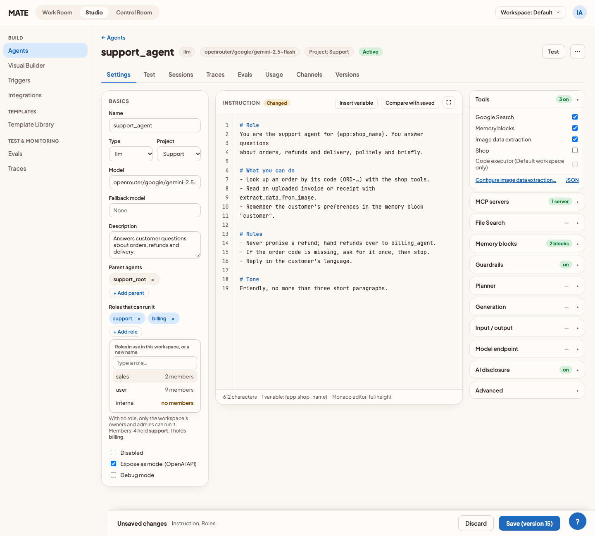
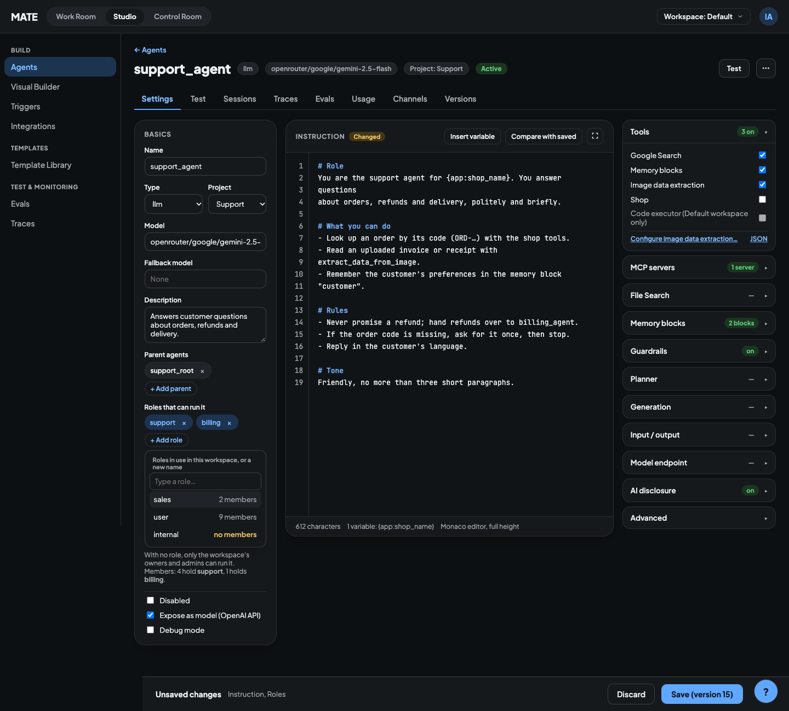
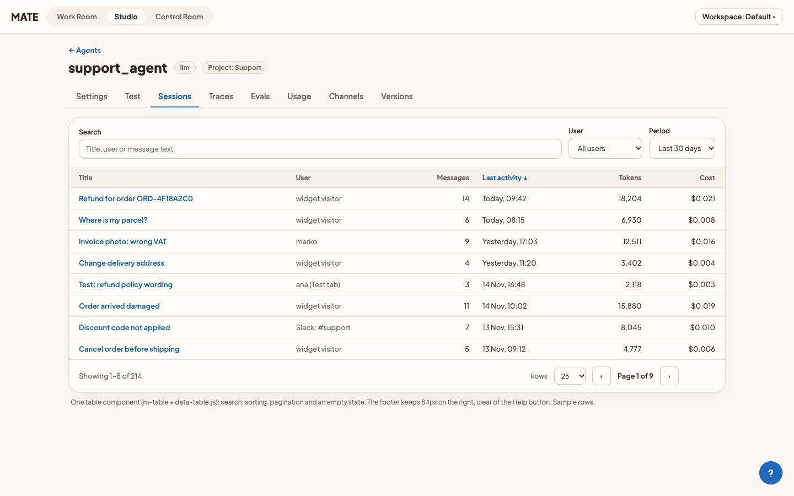
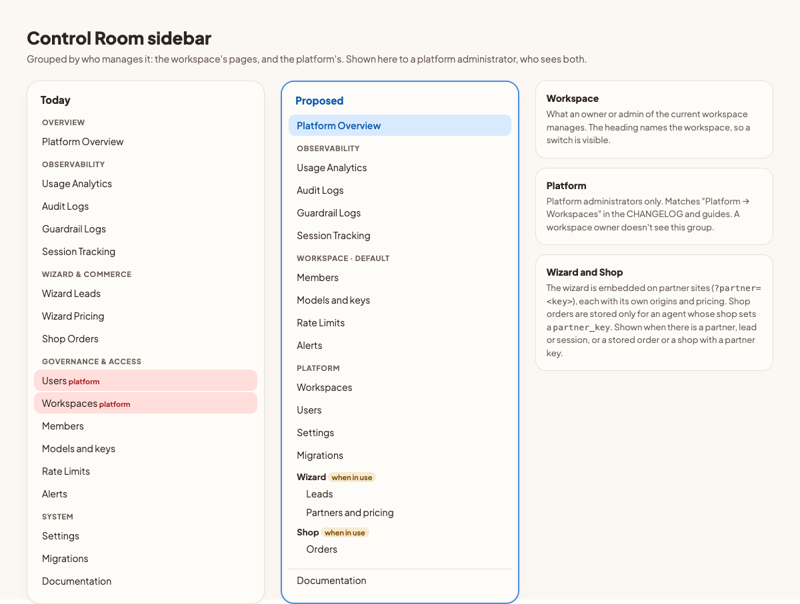
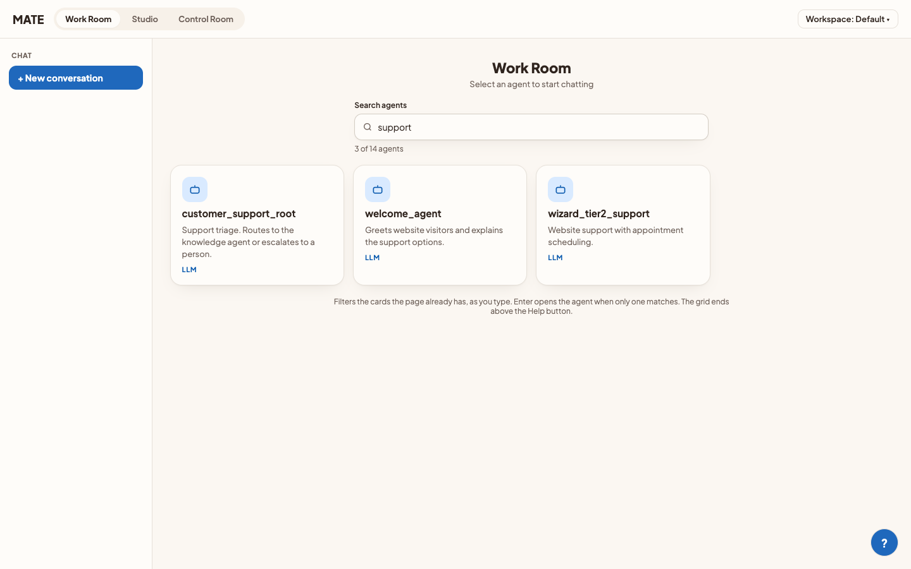
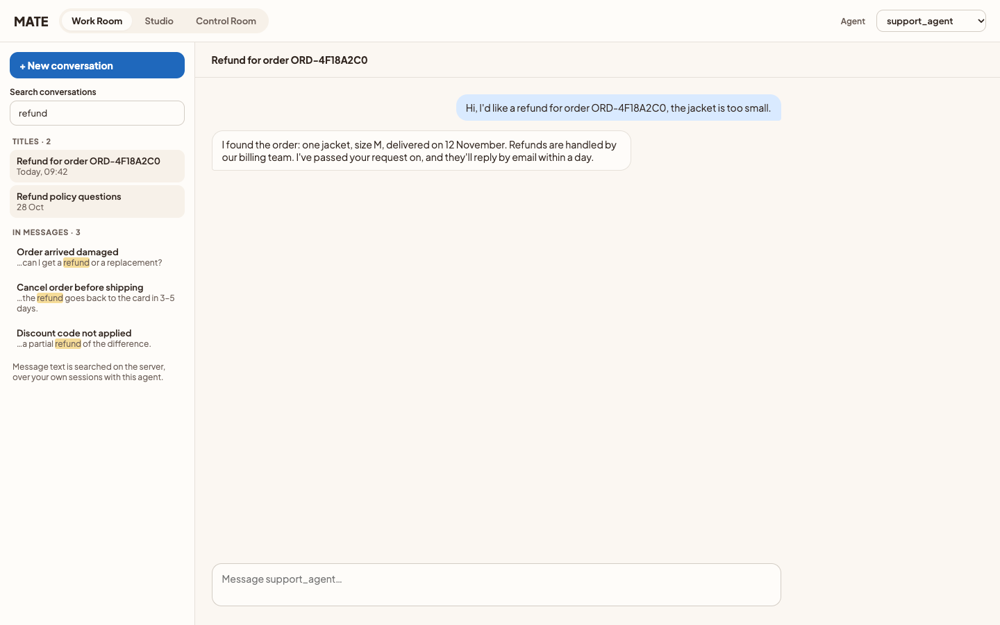

# Design: dashboard redesign for 2.1

Status: proposal for 2.1.0. Tracking: #376, "2.1.0: dashboard redesign".

## Problem

The dashboard grew page by page, and 2.0 added workspaces on top. These are the problems the maintainer and users have run into:

- **Editing an agent is hard.**
  - Create, Edit and Copy Agent are one macro, `templates/dashboard/modals/agent_modal_macro.html`. It opens in an 800px side panel, on **Studio → Agents** and in the Visual Builder.
  - The panel is one column of 28 fields and sections, in this order:
    - name, type, project, model, parent agents;
    - model base URL and key, fallback model;
    - AI disclosure and its waiver, max iterations;
    - description, instruction, roles;
    - memory blocks, tools, File Search, MCP servers;
    - planner, guardrails, generate content config, input and output schemas, include contents;
    - four switches.
  - Parent agents and roles are typed as JSON arrays.
  - Tools, the planner, the generate config and the schemas are JSON with a dialog beside them.
  - The instruction is the agent's main text, but it is one field among the others, and is written in a separate dialog.
- **An agent has no page of its own.** Its sessions, traces, evals, usage, triggers, widget keys and Slack integrations are each on another page, and each page filters differently:
  - **Sessions:** by app name.
  - **Guardrail Logs:** by agent.
  - **Evals:** by agent.
  - **Triggers:** by project and type, not by agent.
- **The sidebar mixes two scopes.** Control Room's "Governance & Access" puts platform pages next to the workspace's own:
  - **Platform pages, shown to platform administrators only:** Users, Workspaces.
  - **The workspace's pages:** Members, Models and keys, Rate Limits, Alerts.
  - The CHANGELOG and the guides say "Platform → Workspaces", a label the sidebar doesn't have.
  - "Wizard & Commerce" is shown to every platform administrator, whether or not the installation sells anything.
- **Two ways of styling.**
  - **The tokens:** the July 2026 redesign (4cadd6d) added OKLCH tokens for both themes in `static/css/redesign.css`. It restyled `base.html`, the Overview and the Work Room on them. The Overview writes them as about 70 inline `style=` attributes.
  - **The other pages** keep their Tailwind classes. `redesign.css` maps those onto the tokens with about 50 `!important` rules.
  - **A class the map misses** keeps Tailwind's colour. #245, Visual Builder dialogs that stayed dark in the light theme, was one.
- **Tables are written page by page.**
  - Pagination is coded separately on Audit Logs, Guardrail Logs, Sessions, Usage and Users.
  - Triggers, Integrations, Alerts, Members, Workspaces and Evals have no search.
  - The Help button covers the bottom-right corner, pagination included (#380).
- **The Work Room has no search.** The welcome page lists every agent the user may run as cards, with no way to filter them. The sidebar shows the 20 most recent sessions (`renderSessions` in `templates/dashboard/workroom.html`), with no search.

## Goals

- **One page per agent,** where everything about it is a tab away.
- **An editor that puts the instruction first** and the rest in order of how often it is changed. No JSON typed by hand for parent agents or roles.
- **A sidebar grouped by scope:** the workspace's pages, and the platform's.
- **New pages built from a small set of components on the existing tokens,** so the light and dark themes come right by construction.
- **Search where there are lists:** tables and the Work Room.

## Non-goals

- **No new frontend framework or build step.** The dashboard stays server-rendered templates with plain scripts (`CLAUDE.md`).
- **No new visual identity.** The tokens, fonts and colours of `redesign.css` stay.
- **Existing pages aren't rewritten all at once.** They move to the components when they are next changed.
- **No changes to the API,** except where a tab needs a filter its page lacks, such as triggers by agent.

## Proposal

### 1. Navigation

The three spaces stay: Work Room, Studio, Control Room. Control Room is regrouped by scope:

```
Control Room
  Overview
  Observability        Usage · Audit Logs · Guardrail Logs · Sessions
  Workspace            Approvals · Members · Models and keys · Rate Limits · Alerts
  Platform             Workspaces · Users · Settings · Migrations      (platform administrators)
                       Wizard Leads · Wizard Partners & Pricing        (when in use)
                       Shop Orders                                     (when in use)
  Documentation
```

As built (step 3): Approvals, added in 2.1, is under Workspace. The wizard's and the shop's pages are items of Platform rather than sub-groups, so the minimized sidebar needs no nested headers. `shared/utils/features_in_use.py` answers "in use" and keeps the answer for a minute.

- **Workspace** holds what an owner or admin of a workspace manages.
- **Platform** holds what only a platform administrator sees. Its name matches what the guides already say.
- **Wizard and Shop** are platform features, under Platform:
  - **The wizard** is embedded on a website (`/wizard/embed`, `mate-wizard.js`). Each partner site has its own key (`?partner=<key>`), allowed origins, pricing and contact (`WizardPartner`, `shared/utils/wizard/partners.py`). Its leads are the platform's.
  - **Shop orders** are stored only for an agent whose `shop` tool config sets a `partner_key` (`shared/utils/tools/shop_tools.py`), and are filed by that key. Wizard trial agents set none, so their test orders aren't stored. Only Default may set `partner_key` (platform-only, `server_credentials`).
  - **Wizard is shown** when there is a wizard partner, lead or session.
  - **Shop is shown** when there is a stored order, or an agent's shop sets a `partner_key`.
  - Both pages stay reachable by URL either way.
- **Studio is unchanged:**
  - Agents, Visual Builder, Triggers and Integrations;
  - Templates;
  - Evals and Traces.
  - The agent page (below) is reached from Agents and from the Visual Builder.

### 2. The agent page

`/dashboard/agents/<name>`. Agent names are unique across the installation. Another workspace's agent answers 404, as every route does (`test_cross_workspace.py`).

```
┌──────────────────────────────────────────────────────────────────────────────┐
│ ← Agents   support_agent   llm · gpt-4.1 · Project: Support      [Test] [⋯] │
│ Settings │ Test │ Sessions │ Traces │ Evals │ Usage │ Channels │ Versions    │
├──────────────────────────────────────────────────────────────────────────────┤
│                       (the selected tab, full width)                          │
└──────────────────────────────────────────────────────────────────────────────┘
```

| Tab | Shows | From |
|---|---|---|
| Settings | The editor, below | The agent's config |
| Test | A chat with the agent, without leaving the page | The Work Room chat |
| Sessions | The agent's sessions, with search | Sessions, filtered by app name |
| Traces | The agent's traces, and Trace Replay | Traces |
| Evals | Its test cases, runs and ratings | Evals, filtered by agent |
| Usage | Tokens and cost over time, by model | Usage |
| Channels | Its triggers, widget keys and Slack integrations | Triggers (needs an agent filter), widget keys, Integrations |
| Versions | Its config versions, with diff and rollback | Version history (`static/js/modals/version-history.js`) |

- **The `⋯` menu:** Copy, Disable, Delete, Export (`/dashboard/api/agents/export`), Open in Visual Builder.

### 3. The editor (Settings tab)

Three columns on a wide screen. On a narrow one they stack in this order: left, centre, right.

```
┌──────────────────────┬─────────────────────────────────────┬─────────────────────────┐
│ BASICS               │ INSTRUCTION                          │ ▸ Tools            3 on │
│ Name    support_agent│ ┌─────────────────────────────────┐ │ ▸ MCP servers      1    │
│ Type    [llm      ▾] │ │ You are the support agent of    │ │ ▸ File Search      —    │
│ Project [Support  ▾] │ │ ...                             │ │ ▸ Memory blocks    2    │
│ Model   [gpt-4.1  ▾] │ │                                 │ │ ▸ Guardrails       on   │
│ Fallback[—        ▾] │ │        (Monaco, full height)    │ │ ▸ Planner          —    │
│ Description          │ │                                 │ │ ▸ Generation       —    │
│ [                  ] │ │                                 │ │ ▸ Input/output     —    │
│ Parents [+ agent   ] │ │                                 │ │ ▸ Model endpoint   —    │
│ Roles   [user ×][+ ] │ └─────────────────────────────────┘ │ ▸ AI disclosure    on   │
│ □ Disabled           │ 1,240 characters · last saved 14:02  │ ▸ Advanced              │
│ □ Expose as model    │                                      │                         │
│ □ Debug mode         │                                      │                         │
├──────────────────────┴─────────────────────────────────────┴─────────────────────────┤
│                                     Unsaved changes   [Discard]  [Save]              │
└──────────────────────────────────────────────────────────────────────────────────────┘
```

Where each of today's fields goes:

| Column | Fields |
|---|---|
| Left, basics | Name, Type, Project, Model, Fallback model, Description, Parent agents (picker), Roles (picker), Disabled, Expose as model, Debug mode |
| Centre | Instruction |
| Right, sections | Tools; MCP servers; File Search; Memory blocks; Guardrails; Planner; Generation (generate content config); Input/output (schemas, include contents); Model endpoint (base URL, API key); AI disclosure (and waiver); Advanced (max iterations; Hardcoded, which only a platform administrator can set) |

- **Each right-hand section is collapsed,** with a one-word summary of whether it is set (`3 on`, `—`).
  - Opening a section shows the form the current dialog has.
  - JSON stays available as a "JSON" toggle inside the section, as `toggleJsonEditor` does today.
- **Pickers:**
  - **Parent agents:** choose from the workspace's agents; it writes `parent_agents` as today.
  - **Roles:** there is no list of roles to manage. A role is a name, matched between an agent's `allowed_for_roles` and a member's agent roles in the workspace (`roles_allow`, `caller_access` in `shared/utils/workspaces.py`).
    - The picker offers the names in use in the workspace: its agents' `allowed_for_roles` and its members' agent roles.
    - A new name can be typed, with the rule the Members page checks (letters, digits, `_`, `.` and `-`; `server/member_routes.py`).
    - The platform roles `admin`, `pending` and `widget` are never offered.
    - With no role chosen, the picker says what that means: only owners and admins of the workspace and platform administrators can run the agent (`roles_allow`: none means admin-only).
    - Each offered name shows how many members hold it, so a role nobody has stands out.
- **Saving:**
  - one Save bar at the bottom, shown when something changed;
  - the dirty check and Escape of #312 carry over;
  - leaving the page with unsaved changes asks first;
  - each save makes a version, as now.
- **Create and Copy use the same editor:**
  - Create is `/dashboard/agents/new`;
  - Copy is `/dashboard/agents/new?from=<name>`.
- **The Visual Builder** opens the agent page instead of the side panel, and its "back" link returns to the canvas (decided: a page, not a dialog over the canvas).
- **The side panel goes** in the editor's PR, on Agents and in the Visual Builder (decided).

### 4. Components

New pages use only these, as classes on the tokens in a new `static/css/components.css`. The prefix is `m-`, so the classes don't collide with Tailwind's.

| Component | Covers |
|---|---|
| `m-card` | Surface, border, radius, shadow (`--bg-surface`, `--border`, `--shadow-card`) |
| `m-btn` with `-primary`, `-secondary`, `-danger`, `-ghost` | Every button |
| `m-field` | Label, input/select/textarea, hint, error, linked `for`/`id` |
| `m-section` | A collapsible section with a summary, as in the editor's right column |
| `m-tabs` | The agent page's tabs; keyboard and `aria-selected` |
| `m-dialog` | The shared dialog (`static/js/dialogs.js`) restyled |
| `m-table` with `static/js/data-table.js` | Search, sort, pagination, empty state, a footer clear of the Help button |

- **The table** pages on the client for lists the page already loads whole, and passes `page`/`q` to the API where the API pages.
- **Existing pages** take the components when they are next changed. When no page uses a remapped Tailwind class any more, its rule in `redesign.css` goes.
- **The Overview's inline styles** move to classes first, since it is already on the tokens.
- **Everything works under `CSP_MODE=enforce`:** no inline `style=` or `on*=` in new markup; `data-click` actions as `docs/dev/content-security-policy.md` describes.

### 5. Search in the Work Room

**Agents.** The welcome page (`/dashboard/workroom` with no agent) shows every root agent the user may run as a grid of cards (`wr-agents-grid`), with no search. With twenty or so agents, the grid runs over several screens.

- **A search box above the grid** filters the cards by name and description as you type. The page already has the whole list, so no route is needed.
- **Enter opens the only match;** no match says so, with the search to clear.
- **The grid leaves room for the Help button** (#380).

**Sessions.**

- **A search box above the session list.** It matches titles as you type, and message text on Enter.
- **The list shows all of the user's sessions** with the agent, loaded as they scroll, not only the latest 20.
- **Matching message text needs the server.** The sessions list doesn't carry every message. That means a search route over the user's own sessions of that agent, scoped like the others.

### 6. Optional: command palette

**Ctrl+K** (⌘K) opens a box that jumps to:
- an agent's page;
- a recent session;
- any dashboard page the user may open.

It is built on the same data as the sidebar and the agent list. It can wait until 1–5 are done.

## Mockups

Drawn with the tokens of `static/css/redesign.css` and its font. The data in them is made up.

**The agent page, Settings tab: the editor**, light and dark:





**The agent page, Sessions tab: the shared table:**



**The Control Room sidebar, today and proposed:**



**The Work Room: searching the agents on its welcome page:**



**The Work Room: searching the sessions:**



## Order

1. **The Help button** (#380), a contributor issue. It can go first, on its own.
2. **Components and the shared table** (`components.css`, `data-table.js`), used first on one existing list page to prove them, Triggers for example.
3. **Navigation by scope.**
4. **The agent page:** the header and tabs, filled one tab at a time.
   - Settings first: the editor replaces the side panel on Agents and in the Visual Builder in the same PR.
   - Then Versions, Sessions, Evals, Usage, Traces, Channels and Test.
5. **Search in the Work Room.**
6. **The command palette,** if there is time.

Each PR:
- has tests;
- keeps `test_route_inventory.py` and `test_cross_workspace.py` green for its routes;
- updates the user guides that name what changed (`docs/user/agents.md`, `docs/user/work-room.md` and others);
- is checked in a browser in both themes, at desktop and phone width, with no CSP report.

## Decisions

Taken by the maintainer on 2026-11-16:

1. **The editor is a page,** `/dashboard/agents/<name>`, not a full-screen dialog over the Visual Builder. A page has a URL, can be linked to and survives a reload.
2. **The side panel is removed** in the editor's PR. It isn't kept for a release once the editor works.
3. **The roles picker reads the roles in use** in the workspace, as above. There is no table of roles.
4. **Wizard and Shop are shown when in use,** by the tests above, under Platform.

## Testing

- **Unit:**
  - `data-table.js` sorting and paging on a fixture, where there is a JS test setup;
  - the new routes (agent page, triggers by agent, session search) with the route inventory and cross-workspace tests.
- **In a browser:**
  - Create, Edit and Copy an agent from Agents and from the Visual Builder;
  - leave with unsaved changes;
  - Escape;
  - each tab with an agent that has no data.
- **Accessibility:**
  - the tabs and sections by keyboard;
  - every field labelled, as #246 checked.
